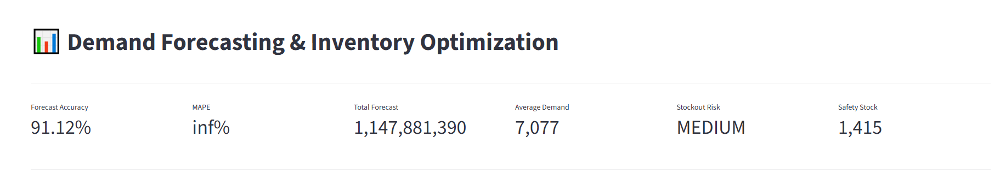
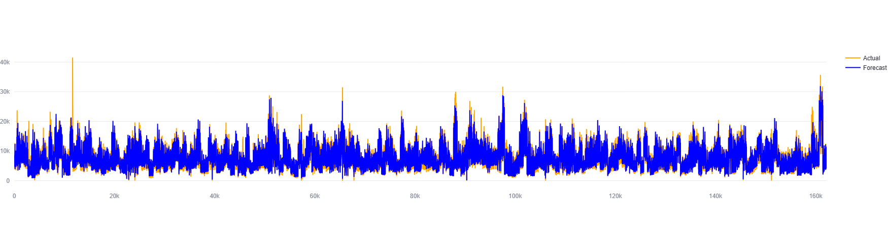
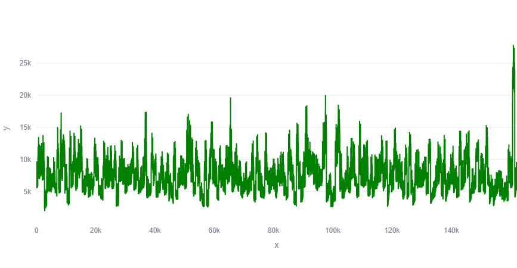
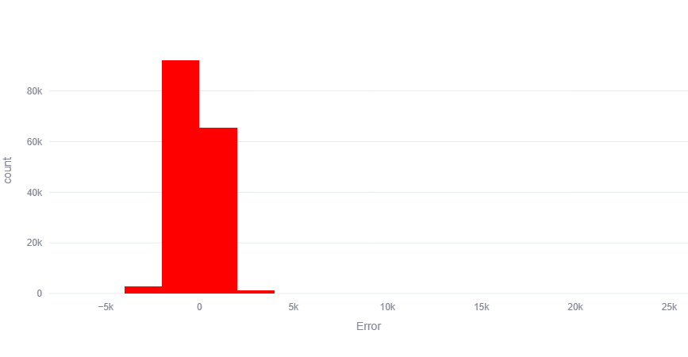
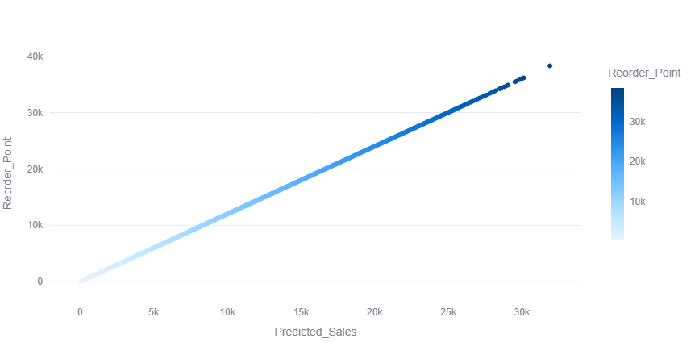
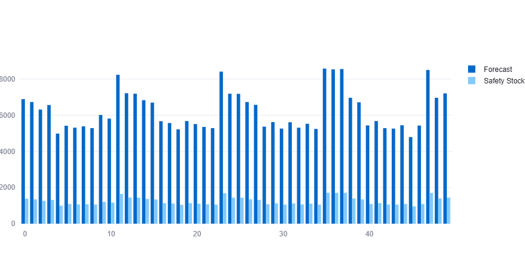

# Demand Forecasting & Inventory Optimization

A Machine Learning-powered inventory optimization system that forecasts product demand, calculates safety stock levels, determines reorder points, and helps businesses reduce stockouts while improving inventory efficiency.

---

## Project Overview

This project combines Demand Forecasting and Inventory Optimization techniques to support data-driven supply chain decisions.

### Key Objectives

* Forecast future product demand using historical sales data
* Optimize inventory planning
* Calculate Safety Stock
* Determine Reorder Points
* Analyze forecasting accuracy
* Visualize insights through an interactive dashboard

---

## Business Problem

Organizations frequently face:

* Overstocking and excess inventory costs
* Stockouts and lost sales opportunities
* Inaccurate demand planning
* Poor inventory turnover
* Inefficient replenishment strategies

This solution helps businesses improve inventory management through predictive analytics and machine learning.

---

## Tech Stack

### Programming & Data Analysis

* Python
* Pandas
* NumPy

### Machine Learning

* Scikit-Learn
* XGBoost

### Visualization

* Matplotlib
* Seaborn
* Plotly

### Dashboard

* Streamlit

### Experiment Tracking

* MLflow

---

## Dashboard Preview

### Inventory Optimization Dashboard



### Actual vs Predicted Demand



### Demand Trend Analysis



### Forecast Error Distribution



### Reorder Point Analysis



### Safety Stock vs Forecast


---

## Project Structure

```text
Demand-Forecasting-Inventory-Optimization
│
├── dashboards/
├── models/
├── notebooks/
├── reports/
├── screenshot/
├── src/
├── requirements.txt
├── run_project.py
└── README.md
```

---

## Features

### Demand Forecasting

* Historical sales analysis
* Future demand prediction
* Forecast performance evaluation
* Trend analysis

### Inventory Optimization

* Safety Stock Calculation
* Reorder Point Calculation
* Inventory Risk Analysis
* Stock Planning Support

### Monitoring

* MLflow Tracking
* Logging
* Health Checks
---
## Workflow

1. Load historical sales data
2. Perform data preprocessing
3. Engineer forecasting features
4. Train XGBoost model
5. Generate demand forecasts
6. Evaluate model performance
7. Calculate inventory metrics
8. Visualize results through Streamlit dashboard

---

## Run the Application

### Install Dependencies

```bash
pip install -r requirements.txt
```

### Launch Streamlit Dashboard

```bash
streamlit run dashboards/app.py
```

### Run Complete Pipeline

```bash
python run_project.py
```

---

## Future Enhancements

* Real-time demand forecasting
* Multi-product inventory planning
* Automated replenishment recommendations
* Cloud deployment
* Advanced forecasting models (LSTM, Prophet)

---

## Author

**Shubham Panchal**

Data Analytics | Data Science | Machine Learning | Business Intelligence

LinkedIn:
https://linkedin.com/in/shubham-panchal-a100282a8

<!-- auto-update 2024-05-31 18:25:18 -->

<!-- auto-update 2024-06-02 18:25:18 -->

<!-- auto-update 2024-06-04 18:25:18 -->

<!-- auto-update 2024-06-06 18:25:18 -->
